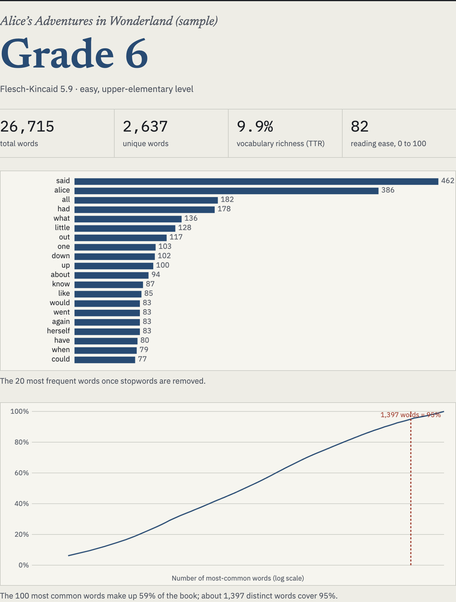

# EPUB reading-level analyzer

A browser tool that reports how hard a book is to read: Flesch-Kincaid grade, vocabulary richness and a vocabulary coverage curve, computed on your device with nothing uploaded.

[Live app](https://lyhjeremy.github.io/epub-reading-level-analyzer/) · [Write-up](https://lyhjeremy.github.io/epub-reading-level-analyzer/overview/)

Design and copy follow [these standards](https://github.com/lyhjeremy/lyhjeremy/blob/main/DESIGN_STANDARDS.md).

## Sample result

The bundled public-domain sample, *Alice's Adventures in Wonderland*:

| Measure | Value |
|---|---:|
| Flesch-Kincaid grade | 5.9 (shown as grade 6) |
| Flesch reading ease | 82 |
| Words / distinct words | 26,715 / 2,637 |
| Type-token ratio | 9.9% |
| Share of text from the top 100 words | 59% |
| Distinct words for 95% coverage | 1,397 |



## What it computes

- Flesch-Kincaid grade and Flesch reading ease, from words per sentence and a vowel-group syllable heuristic.
- Type-token ratio, with total and unique word counts.
- The 20 most frequent words after a stopword list.
- A coverage curve: the share of all tokens covered by the N most frequent words, on a log axis, with the 95% point marked.

The same coverage measurement drives my [Love Island lexical analysis](https://lyhjeremy.github.io/love-island-lexical-analysis/), which used a Python pipeline; this tool puts it in a web page that works on any book.

## How it works

An EPUB is a ZIP archive of XHTML files. A short ZIP reader in the page finds the central directory and inflates each chapter with the browser's native [`DecompressionStream`](https://developer.mozilla.org/docs/Web/API/DecompressionStream) (`deflate-raw`). `DOMParser` extracts the text, and the scoring and `<canvas>` charts run in the same page, without third-party libraries or a server. The only network request loads the bundled sample when you click it.

Stack: vanilla HTML, CSS and JavaScript in a single `index.html`.

## Limitations

- Flesch-Kincaid measures sentence and word length only. Short sentences about hard ideas score as easy.
- Type-token ratio falls with text length, and the tool does not correct for it.
- Coverage counts word forms ("run" and "ran" are two words), so counts run higher than the word-family figures in language-teaching research.
- English only: the tokenizer keeps the letters a to z.

## How to run

Open the [live app](https://lyhjeremy.github.io/epub-reading-level-analyzer/), or serve the folder locally (the sample loads with `fetch`, which needs HTTP):

```bash
python3 -m http.server 8000   # then open http://localhost:8000/
```

## License

[MIT](LICENSE) © 2026 Jeremy Lee. The sample text is public domain, from Project Gutenberg.
